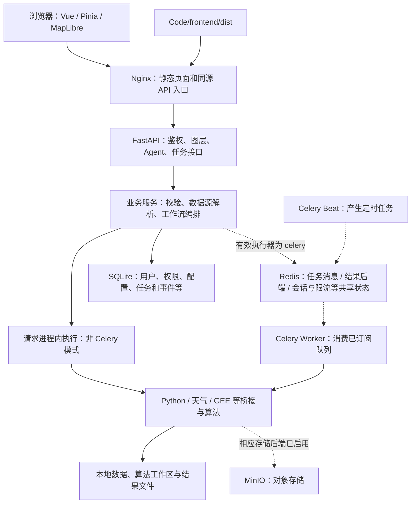

# GeoFlow 星地融合土壤数据平台

**WebGIS 独立部署与二次开发交付方案 · v1.0.0**

GeoFlow 是面向遥感科研和地理数据分析的网页平台。使用浏览器即可查看地图、叠加遥感图层、按日期浏览观测，并按坐标或区域比较数据随时间的变化。平台基于 CGDA 综合地理数据分析系统。合作单位可以在自己的电脑或服务器运行这份源码，接入自己的数据，继续开发产品、算法、工作流和地图助手。

[平台能做什么](#2-平台简介与主要能力) · [独立部署](#6-独立部署与首次登录) · [跑通合成样例](#7-平台示例与合成样例验收) · [二次开发](#9-二次开发与新产品接入)

## 1. 项目定位与交付版本

本页面向拿到交付源码、第一次使用 GeoFlow 的合作单位。`v1.0.0` 是独立私有仓库中已发布的验收版本，包含前端、后端、算法、地图助手、Compose 部署配置、合成样例和分层 README。部署时在源码目录之外生成自己的账号与服务配置，运行数据保存在接收方的环境里。

[交付版本与下载](https://github.com/2868185723/WebGIS-Standalone-Delivery/releases/tag/v1.0.0) · [交付验收记录](Docs/交付验收记录.md)

## 2. 平台简介与主要能力

| 功能 | 用来做什么 | 操作入口 | 输入与结果 | 使用条件 |
| --- | --- | --- | --- | --- |
| 地图、图层与时间轴 | 浏览、定位和叠加地理数据，查看选定日期的观测 | 主工具栏「底图」、左侧图层、底部时间轴 | 底图提供地理参照，业务图层显示带位置的数据；选中图层后可查看其日期、图例和单位 | 图层已有可显示的本地或已接入数据，在线底图由部署方配置 |
| 风云与 SMAP 遥感产品 | 展示遥感反演变量，并按实际数据日期查看 | 左侧图层的「研发产品」及「时序分析」的产品选择 | 代码有风云与 SMAP 的平均散射约束、动态散射约束两类产品组织，变量包括土壤水分（SM，m³/m³）、植被光学厚度（VOD，无量纲）、等效散射（ω，无量纲） | 随包只有合成样例；真实产品数据及其来源由合作单位提供 |
| 点位时序 | 查看同一个位置在不同时间的像元值。像元是栅格中的一个小格 | 主工具栏「时序分析」→「点位分析」 | 选择产品与日期范围，输入经纬度或用「地图选点」；生成曲线、数据表和对应单位 | 点位与栅格覆盖重叠，选定日期及像元有数据 |
| 区域时序 | 对同一个区域逐期计算统计量 | 主工具栏「时序分析」→「区域分析」 | 选择区域几何、日期范围和统计量；返回逐期统计以及有效像元与覆盖率 | 区域与数据重叠，结果按所选统计方法计算 |
| 工作流 | 把读取、预处理、算法和结果输出组织成可复用步骤 | 主工具栏「工作流」和「运行」 | 画布中的节点表示处理步骤，连线表示数据依赖；运行后从任务记录查看状态和产物 | 账号有对应权限，工作流引用的输入和参数可用 |
| 地图助手 | 用自然语言查找或操作地图图层 | 地图页面的「打开地图助手」按钮 | 从当前页面状态解析目标，生成图层或日期操作，由前端执行并反馈 | 图层和数据应在当前会话可访问，在线对话还需要配置模型 |

**产品、图层与文件的关系。** 产品定义数据来源、所用算法版本和可查看的变量。例如「风云平均散射约束产品」下的 VOD，可作为一个图层叠加到地图。一期 GeoTIFF 是一份带空间位置的栅格文件，保存该日或该统计周期的数据。地图会按当前图层的时态和选定日期加载相应数据，详细范围由该产品的数据、已有结果或日期索引决定。时序模块可同时识别本地合成期和已接通的部分 NAS 原始逐日观测。当前 NAS 逐日适配限于配置了目标映射的 SM 和 VOD，等效散射的日序气候态有自己的产品含义。样例采用月度栅格。

**显示与选中可以分别操作。** 勾选通常显示图层并设为当前查看对象，点击图层行可以只切换当前对象。取消勾选时可保留当前选中状态。独立时间模式下，每层记忆自己的时间，切换图层时恢复该时间。使用统一时间锁时，显示按相应时间模式同步。颜色由图例映射数值，点查和分析结果还要核对所示单位。

**空日期、范围外与缺测。** 地图上的空白可能来自尚未加载的日期、视野超出栅格范围或 NoData 像元。NoData 是文件中标记无观测的值，与真实数值 `0` 分开统计。点位时序读取坐标所在像元。区域时序以像元中心落入真实边界为准，过滤无效值后计算均值、标准差、最小值或最大值。区域均值和标准差按像元面积处理。EPSG:6933 栅格使用等权，其余坐标系按像元大地面积加权。覆盖率是有效像元数除以区域内像元总数。具体空结果及排查见[样例与排查](#7-平台示例与合成样例验收)。

## 3. 按读者选择阅读路线

| 你需要完成的事 | 从哪里开始 |
| --- | --- |
| 第一次使用平台 | 先看[主要能力](#2-平台简介与主要能力)，然后[部署并登录](#6-独立部署与首次登录)，按[平台示例](#7-平台示例与合成样例验收)完成数据导入及两种时序分析。 |
| 负责部署和维护 | 优先看[独立部署](#6-独立部署与首次登录)、配置、数据卷和[常见问题](#11-常见问题与排查)。 |
| 负责二次开发 | 看[系统架构](#4-系统架构与组件协作)、[目录与开发入口](#5-目录职责与开发入口)，再按[新产品接入](#9-二次开发与新产品接入)找文件和做验证。 |

## 4. 系统架构与组件协作

前端负责地图、图层与交互状态，FastAPI 负责权限、数据访问和业务编排，Python 算法提供方（Provider）连接工作流与计算模块。工作流把任务状态、进度、取消和结果引用连接起来；Agent 复用这些已有能力，并把需要改变页面的操作交回前端执行。

下图对应本交付版的 [Compose](deploy/compose.yaml)、[网关配置](deploy/nginx.conf) 和实际源码。实线表示当前主链；虚线表示按有效配置或运行条件使用的路径。API 是网页和服务器交换数据的接口。

### 4.1 浏览器如何访问服务

按交付配置启动后，默认只向本机发布网关端口：

| 地址 | 用途 |
| --- | --- |
| `http://127.0.0.1:25175/` | 网站入口，端口可由 `DELIVERY_HTTP_PORT` 调整 |
| `http://127.0.0.1:25175/health` | 后端健康接口，由网关转发 |
| `http://127.0.0.1:25175/openapi.json` | 实际 API 结构，用于接口核对和类型生成 |
| `http://127.0.0.1:25175/docs` | 仅显式启用 `BACKEND_DOCS_ENABLED` 后提供；当前 `production` 模式默认关闭，返回 404 是预期行为 |

前端通过 [`services/_http.ts`](Code/frontend/src/services/_http.ts) 统一处理 API 地址、请求凭据、错误和取消。网关把 `/auth`、`/layers`、`/analysis`、`/workflow-runs`、`/agent` 等转发到容器内 `backend:8000`。Redis 和 MinIO 的 `redis:6379`、`minio:9000` 也是容器内地址，默认没有对应的宿主机公开端口。

生产网页是预先构建的 `Code/frontend/dist`，以只读目录挂载给 Nginx；网关没有运行 Vite 开发服务器。修改前端后需要重新构建该目录。后端、共享 Python 代码和算法代码被复制进后端镜像，修改后需要重建镜像，并更新 API 及使用该镜像的相关 Worker。操作方法见 [部署与运行](Docs/部署与运行.md)。

### 4.2 一次真实的点位时序分析如何完成

以“为指定产品和坐标生成逐期曲线”为例，其入口和数据流如下。区域分析使用相同链路，输入换成真实 `Polygon` / `MultiPolygon`。

1. [`TimeSeriesWorkspace.vue`](Code/frontend/src/components/timeseries/TimeSeriesWorkspace.vue) 调用 [`services/spatial-timeseries.ts`](Code/frontend/src/services/spatial-timeseries.ts)，读取 `/analysis/time-series/products` 和产品 `availability`。后端 [`spatial_timeseries_service.py`](Code/backend/app/services/spatial_timeseries_service.py) 按产品、变量、权限和数据源构造观测期；已配置并匹配的 NAS 逐日产品读取远端目录索引，合成期读取已登记的本地科学栅格。
2. 用户提交后，`POST /analysis/time-series/runs` 进入 [`spatial_timeseries_router.py`](Code/backend/app/api/routers/spatial_timeseries_router.py)。路由校验访问权限，`build_plan` 校验经纬度、日期、时间尺度或真实多边形，再组装 `WorkflowSubmitRequest`。无数据源、超出真实观测范围等问题在此返回错误，不能由界面预览值替代。
3. 请求交给共用的 [`workflow/submission_service.py`](Code/backend/app/services/workflow/submission_service.py)，记录任务和事件，按有效执行器选择请求内计算或 Celery 派发。两条路径都复用任务状态、取消和结果引用机制。
4. [`tasks/workflow_tasks.py`](Code/backend/app/tasks/workflow_tasks.py) 选择 Provider 桥接；[`modules/spatial_timeseries.py`](Code/algorithms/providers/Python/modules/spatial_timeseries.py) 启动独立读取子进程，调用 [`shared/spatial_timeseries.py`](Code/shared/spatial_timeseries.py)。NAS 观测由 [`spatial_timeseries_source.py`](Code/backend/app/services/spatial_timeseries_source.py) 读取原始文件和原生网格，本地期直接读取科学栅格；计算读取真实像元，并按区域边界选择有效像元，保留缺测状态。MapLibre 加载预览图或瓦片（按地理范围切成的图块）用于地图显示，分析使用原始科学栅格。
5. 前端读取 `/workflow-runs/{run_id}` 的状态与结果引用，展示曲线、数据表或具体失败原因。结果由 [`result_storage.py`](Code/backend/app/services/result_storage.py) 和 [`object_store.py`](Code/backend/app/services/object_store.py) 管理，较小的结果可放在响应内，文件结果通过产物引用访问。

**同步和异步要分别判断。** 返回 `202` 和 `run_id` 表示使用任务接口，不等于本次计算已经进入 Celery。`submission_service.py` 在非 Celery 模式下直接调用 `process_workflow_run`，因此提交请求可能等待计算完成才返回；算法模块使用子进程，也不等于使用 Celery。

本标签的 `deploy/compose.yaml` 没有指定 `BACKEND_WORKFLOW_EXECUTOR`，代码环境默认值为 `sync`；新任务库的初始配置显示为 `in_memory`，同样走非 Celery 分支。已有数据库中的 `backend.task_executor` 可以覆盖环境默认值；[`effective_config.py`](Code/backend/app/services/effective_config.py) 的实际投影和 [`workflow/transition_builder.py`](Code/backend/app/services/workflow/transition_builder.py) 决定派发方式。判断实际队列与执行方式时，以生效设置和运行日志为准。

### 4.3 接口契约如何保证前后端一致

接口契约就是双方约定的字段与含义。改动时先定位真实模型，再检查前端使用处。

| 信息 | 实际字段或入口 |
| --- | --- |
| 产品与时间 | 时序请求用 `product_id`、`start`、`end` 和 `cadence`；返回的可用期由后端按产品和读源整理。 |
| 空间范围 | 点位为 `[经度, 纬度]`，区域使用 `geometry` 中的 WGS84 多边形。 |
| 变量、单位和结果 | 产品返回变量与单位，结果按期包括 `value`、`status`、有效像元计数和覆盖率等。 |
| 工作流状态和错误 | `run_id` 关联任务状态、事件及产物引用，失败时结合提交接口和运行记录阅读错误。 |

通用工作流等请求和响应位于[共享 Pydantic 模型](Code/shared/contracts/api_contracts.py)，前端可从 OpenAPI 接口结构生成 TypeScript 类型。时序实际请求模型在[时序路由](Code/backend/app/api/routers/spatial_timeseries_router.py)，时序和助手还有[时序前端约定](Code/frontend/src/services/spatial-timeseries.ts)及[助手前端约定](Code/frontend/src/services/agent-api.ts)等手写类型。修改这些接口时逐一核对对应调用方。[前端类型脚本](Code/frontend/package.json) · [开发回归](Docs/二次开发.md#7-回归方式)

### 4.4 Redis、Worker、Beat 和 MinIO 各自负责什么

| 组件 | 实际职责和边界 |
| --- | --- |
| FastAPI | 处理普通查询、配置、权限、Agent 请求和工作流编排；普通图层查询和 Agent 对话不要求都经过 Celery |
| Redis | Compose 配置为 Celery 消息代理和结果后端；应用也使用它处理会话、限流等共享状态。它不是科学栅格仓库，也不替代 SQLite 的业务记录 |
| `worker` | 一个通用 Celery Worker，订阅多条队列；当前 `solo`、并发数 1。订阅多队列不等于有同等数量的独立 Worker |
| `worker-timeseries` | 配置了订阅 `geoflow-spatial-timeseries` 的专用 Worker；当前源码的时序提交未设置该专用队列标识，启用 Celery 后仍要在接收确认中核对实际队列 |
| `beat` | 独立定时调度进程，负责触发任务而非承担算法计算；本 Compose 显式关闭 Open-Meteo 自动同步 |
| MinIO | 可用的对象存储服务；当前 `storage_backend`、`object_store_backend` 默认均为 `local`，仅配置 MinIO 地址和启动容器，不会自动将全部输入和结果迁移到 MinIO |
| `init-admin` | 一次性初始化空账户库中的首个管理员，发现已有账户就保留；不是长期运行的 API |
| `sample-loader` | 仅 `samples` profile 下运行的一次性样例加载器；不会自动导入用户的真实科研数据 |

外部天气、GEE、模型和 NAS 还需要各自的数据源配置、凭据、权限与网络条件。默认 `application` 网络设置为内部网络；可选出网覆盖文件不等于外部服务已经开通，也不会自动补齐数据。

### 4.5 哪些东西保存在哪里

下表是未另设部署配置、使用新数据卷时由 Compose 和 [`core/config.py`](Code/backend/app/core/config.py) 推导的路径。Docker 命名卷的物理目录由 Docker 管理，不能把容器路径直接当作宿主机路径使用。

| 卷或挂载 | 容器位置 | 保存内容 |
| --- | --- | --- |
| `geo-input` | `/runtime/data` | 输入数据根；默认运行时根同时派生为 `/runtime/data/_runtime`，其中 `workflow_state` 保存用户、权限、配置、任务及事件等 SQLite 数据，`artifacts` 保存本地产物，`python_provider` 保存算法工作区，另有日志和应用缓存 |
| `geo-output` | `/runtime/output` | 明确设置的产出根目录，供输出和样例加载链路使用；它不包含所有运行时数据 |
| `application-state` | `/srv/Code/backend/.data` | 仍使用此路径的后端独立状态文件，例如默认 `spatial.sqlite`；不要将其误认为唯一数据库卷 |
| `application-cache` | `/runtime/cache` | `XDG_CACHE_HOME` 指向的依赖缓存；应用自己的 `cache_dir` 默认仍是 `/runtime/data/_runtime/cache` |
| `redis-data` | Redis 容器的 `/data` | Redis AOF 持久化数据 |
| `object-data` | MinIO 容器的 `/data` | 实际写入 MinIO 的对象；默认本地产物不会自动出现在这里 |
| 前端 `dist` 只读目录 | `/usr/share/nginx/html` | 编译好的网页资源，不保存用户数据 |

部署配置和环境变量可以覆盖部分运行路径。备份和迁移时同时核对有效配置、数据卷、业务数据库和密钥。

## 5. 目录职责与开发入口

### 5.1 先认识源码目录

源码根目录就是包含本 README、`Code/` 和 `deploy/` 的文件夹。Git 仓库用于保存这些文件及其版本历史，解压 ZIP 后也能按同样的目录阅读与部署。

| 目录 | 负责什么 | 输入、输出或关联 | 何时从这里改 |
| --- | --- | --- | --- |
| [前端](Code/frontend/) | 网页、地图、图层、时间轴、工作流画布和交互状态 | 从 API 读取目录、数据和任务，再展示在浏览器中 | 改页面、地图交互、图表或前端数据连接 |
| [后端](Code/backend/) | FastAPI、账号与权限、数据读取、任务及接口 | 接受页面请求，处理数据、调度算法并返回结果 | 改接口、数据接入、任务和权限 |
| [算法](Code/algorithms/) | 平台可调用的算法模块、输入适配、工作流执行 | 接收数据及参数，输出数值、图层或结果文件 | 加入计算方法、新格式或产物 |
| [工作流定义](Code/backend/workflow_seeds/) | 系统工作流的初始定义 | 用节点和连线描述输入、计算和产物 | 登记可复用的系统处理流程 |
| [地图助手资源](Code/agentKits/) | 提示词、工具格式和预设配置 | 由后端编排和前端地图动作共同使用 | 调整提示词或工具描述，执行层也按需修改 |
| [共享契约](Code/shared/) | 共享请求、结果和相关计算约定 | 工作流请求、状态、结果引用及地理计算由多个组件复用 | 改产品、任务或结果字段并检查调用方 |
| [部署](deploy/) | 编排、镜像构建、账号初始化、样例加载 | 使用私有配置及数据卷启动独立站 | 调整端口、挂载、网关或容器配置 |
| [合成样例](samples/) · [测试](Test/) | 可运行的固定样例、分层回归用例 | 检查部署、操作链路和改动后的行为 | 补可复现的试验数据与测试 |
| [项目文档](Docs/) · [辅助工具](Tools/) | 交付说明、实际验收范围、生成与检查脚本 | 可查启动方式及目录检查方法 | 更新接手说明或维护生成结果 |

### 5.2 我想改什么，从哪里开始

| 想修改的内容 | 优先看 | 修改后检查 |
| --- | --- | --- |
| 页面布局和地图交互 | [主页面](Code/frontend/src/views/DashboardView.vue) · [地图组件](Code/frontend/src/components/MapCanvas.vue) | 登录后交互、点选与地图定位 |
| 显隐、选中和时间轴 | [图层状态](Code/frontend/src/stores/layers/active-layers.ts) · [时间同步](Code/frontend/src/views/dashboard/useTimelineSync.ts) | 切换图层后，显隐和日期各按其规则变化 |
| 图例、色带与数据范围 | [有效图层样式](Code/frontend/src/components/map/effective-layer-symbology.ts) · [色带种子](Code/backend/app/catalog_seeds/palettes.json) | 同一产品的地图、数值、图例和单位一致 |
| 新增遥感产品 | [图层目录](Code/backend/app/catalog_seeds/layer_descriptors.json) · [工作流种子](Code/backend/workflow_seeds/system/) | 能找到产品、可用日期及正确产物 |
| 点位或区域分析 | [时序面板](Code/frontend/src/components/timeseries/TimeSeriesWorkspace.vue) · [接口](Code/backend/app/api/routers/spatial_timeseries_router.py) · [计算](Code/shared/spatial_timeseries.py) | 用已知值、区域边界和 NoData 核对 |
| 加算法或画布节点 | [算法模块](Code/algorithms/providers/Python/modules/) · [节点模板](Code/backend/app/services/node_template_registry.py) · [画布编译](Code/backend/app/services/workflow_graph_compiler.py) | 可提交、执行并读取预期产物 |
| 扩展地图助手 | [工具定义](Code/agentKits/tools/) · [后端编排](Code/backend/app/services/agent/orchestrator.py) · [页面动作](Code/frontend/src/components/agent/agent-ui-intent.ts) | 指令解析、目标匹配、实际动作与回执一致 |
| 修改独立部署 | [Compose](deploy/compose.yaml) · [网关](deploy/nginx.conf) · [配置初始化](deploy/init_config.py) | 端口、健康检查、网络范围与数据保留 |

交付部署以 `deploy/` 的 Compose 为入口。根目录的 `launch.py`、`start.bat` 和 `start.sh` 是原项目开发辅助入口。[系统说明](Code/README.md) · [二次开发约定](Docs/二次开发.md)

## 6. 独立部署与首次登录

Compose 用一份文件启动相互依赖的服务。镜像是已经准备好运行环境的模板，容器是镜像启动后的独立进程，数据卷是 Docker 管理的持久化存储。使用相同项目名及数据卷重启时，已有账号和数据可以继续使用。首次部署还需要构建网页、生成私有配置和创建空库中的首位管理员。

当前验收在 Windows 部署机上使用 PowerShell 与 Linux 容器完成。以下命令采用同样的环境。其他 Linux 或 WSL 环境需要由接收方核对本机 Docker 和路径行为。

| 安装什么 | 要求和作用 |
| --- | --- |
| Node.js、npm | Node.js 22、npm 10 或以上，用于安装并构建网页。 |
| Python | 3.12，用于初始化配置及运行样例检查脚本。后端容器自带自己的 Python。 |
| Docker 与 Compose | 准备运行中的 Docker 和 `docker compose` 命令，Windows 上使用 Docker Desktop 的 Linux 容器模式。首次构建需要能够访问镜像、系统包和 npm/Python 依赖源，或使用部署方准备的镜像和缓存。 |
| 浏览器 | 用于打开本机部署入口、登录及使用地图和分析。 |

### 6.1 核对交付文件并进入源码目录

1. 在有权限的 GitHub 账号中打开[交付发布页](https://github.com/2868185723/WebGIS-Standalone-Delivery/releases/tag/v1.0.0)，下载 `GeoFlow-Delivery-v1.0.0.zip` 和同名 `.sha256` 文件。已有 Git 工作区的开发人员可选择检出 `v1.0.0` 标签。
2. 在放置下载文件的目录打开 PowerShell，执行下面两行，把计算出的 Hash 与校验文件首列比较。校验一致后解压 ZIP。

~~~powershell
Get-FileHash .\GeoFlow-Delivery-v1.0.0.zip -Algorithm SHA256
Get-Content .\GeoFlow-Delivery-v1.0.0.sha256
~~~

3. 在 PowerShell 进入解压后的源码根目录。将命令中引号内的占位文字替换为实际绝对路径。最后两行都应返回 `True`；否则继续进入包含 `deploy/` 和 `Code/` 的那一级。

~~~powershell
Set-Location '<源码根目录的实际路径>'
Get-Location
Test-Path .\deploy\compose.yaml
Test-Path .\Code\frontend\package-lock.json
~~~

### 6.2 构建网页

在源码根目录打开 PowerShell。前四行检查工具和容器类型，后面的命令进入前端目录安装依赖并构建。

~~~powershell
node --version
python --version
docker compose version
docker info --format '{{.OSType}}'

Push-Location Code/frontend
npm ci
$env:VITE_BEHIND_GATEWAY = '1'
node node_modules/vite/bin/vite.js build
Pop-Location
~~~

Docker 的容器类型应显示 `linux`。构建结束后，确认存在 `Code/frontend/dist/index.html`，网关会读取该目录。若依赖下载或构建错误，先核对版本、命令执行目录及软件源。已有验收的构建依赖来自与锁文件一致的本机副本，接收方首次安装使用自己的软件源或缓存。

### 6.3 生成本单位的私有配置

~~~powershell
python deploy/init_config.py --output ../geoflow-private/runtime.env
~~~

这个命令在源码目录之外创建运行配置，并随机生成初始密码、加密密钥和服务鉴权材料。它不会在终端打印这些值。请在本地编辑器中查看和保管文件，不把内容提交到 Git 或贴到公开问题记录中。

脚本支持 --admin 指定初始管理用户名，--port 指定独立入口端口。管理用户名需以英文字母开头，长度为 3—32 个字符，其余字符可使用英文字母、数字、下划线或连字符；端口由脚本校验。默认入口为 25175。配置必须位于源码目录之外，已有同名文件不会被覆盖。

| 实际配置项 | 作用 | 是否必填 | 占位示例 | 缺少时的影响 |
| --- | --- | --- | --- | --- |
| `DELIVERY_HTTP_PORT` | 宿主机上的网页入口端口 | 否，编排默认为 `25175` | `25175` 或另一个可用端口 | 使用默认值；已占用时网关无法绑定 |
| `DELIVERY_ADMIN_USER` | 首次空账户库的管理员名 | 是，由初始化生成；可用 `--admin` 指定 | `<自定管理员用户名>` | Compose 缺少必填字段 |
| `DELIVERY_ADMIN_PASSWORD` | 首次创建的管理员密码 | 是，由初始化随机生成 | `<本机新生成的管理密码>` | Compose 缺少必填字段 |
| `DELIVERY_ENCRYPTION_KEY` | 应用保存加密凭据的材料 | 是，由初始化生成 | `<本机生成的加密密钥>` | Compose 缺少必填字段 |
| `DELIVERY_SERVICE_KEY` | 服务之间使用的鉴权材料 | 是，由初始化生成 | `<本机生成的服务密钥>` | Compose 缺少必填字段 |
| `DELIVERY_MINIO_USER` | 容器内 MinIO 对象存储账号 | 是，由初始化生成 | `<本机生成的对象存储账号>` | Compose 缺少必填字段 |
| `DELIVERY_MINIO_PASSWORD` | 容器内 MinIO 对象存储密码 | 是，由初始化生成 | `<本机生成的对象存储密码>` | Compose 缺少必填字段 |

随包[字段模板](deploy/.env.example)中的空值用于查阅字段。正常首次启动直接运行 `init_config.py`。合成样例复用这份配置和自动创建的数据卷。真实 NAS、在线模型、GEE 和其他服务的地址、网络与授权另按接入场景准备。

后续构建、启动、查看日志和停止命令，都要使用同一份配置文件和同一个 Compose 项目名。

### 6.4 构建后端并启动

回到源码根目录并确认外置配置已生成。Compose 会创建所需的数据卷。网页静态目录由第 6.2 步构建，样例首次运行使用自动创建的卷。

~~~powershell
# 校验编排与必需字段，不展开打印私有配置。
docker compose -p geoflow-delivery --env-file ../geoflow-private/runtime.env -f deploy/compose.yaml config --quiet

docker compose -p geoflow-delivery --env-file ../geoflow-private/runtime.env -f deploy/compose.yaml build backend
docker compose -p geoflow-delivery --env-file ../geoflow-private/runtime.env -f deploy/compose.yaml up -d

# 包含已经正常退出的一次性服务。
docker compose -p geoflow-delivery --env-file ../geoflow-private/runtime.env -f deploy/compose.yaml ps --all
~~~

编排启动后端 API、通用任务进程、时序分析任务进程、调度进程、Redis、MinIO 和网页网关。init-admin 是一次性账户初始化服务：账户库为空时创建首位管理员；已有账户时保留原账户。它显示 Exited (0) 属于正常完成，不需要为了保持 Up 而反复启动。

启动了任务进程，不表示所有请求默认都进入 Celery。当前交付的默认工作流使用同步/in_memory 执行路径；启用 Celery 后，再按实际任务路由查看相应队列和进程。排查时先看提交接口、返回状态与后端日志。

正常时 `backend` 和 `gateway` 应通过健康检查。未就绪时先按第 6.7 节读日志。

只有 `gateway` 发布网页端口，默认地址为 [http://127.0.0.1:25175/](http://127.0.0.1:25175/)。后端、Redis 和 MinIO 通过内部网络连接，不需要另外开放它们的端口。

如果修改了 DELIVERY_HTTP_PORT，浏览器地址也应使用相应端口。`127.0.0.1` 指浏览器所在的这台机器，本机回环入口只供部署机访问。跨设备使用时，由合作单位按自身网络设置反向代理或其他受控访问入口并配置相应地址和 HTTPS。

### 6.5 首次登录

1. 在部署机打开上面的网页入口。
2. 从本地私有 runtime.env 文件读取 DELIVERY_ADMIN_USER 和 DELIVERY_ADMIN_PASSWORD，填入登录页的“用户名”和“密码”。
3. 点击“账号登录”，进入主界面。

初始密码只在创建空账户库的首位管理员时生效。已有账户后，重新生成配置或修改配置中的密码，不会自动修改数据库里原有账号的密码。首次登录与账户维护应使用管理员账号，不用游客入口替代管理员身份。

### 6.6 保留运行数据

沿用相同的项目名（本例为 `geoflow-delivery`）及私有配置文件，Compose 会继续使用原有数据卷。默认账户与任务 SQLite 保存在 `geo-input` 中的运行目录，样例写入 `geo-output`。各卷职责见[容器路径与存储](#45-哪些东西保存在哪里)。

日常停止和恢复按下一节执行。删除或清空数据卷会影响其中的输入、账户或产物，应根据卷的职责和备份安排单独处理。备份时把必要的数据卷和外置配置一起保管。

### 6.7 查看状态、日志、停止与恢复运行

~~~powershell
docker compose -p geoflow-delivery --env-file ../geoflow-private/runtime.env -f deploy/compose.yaml ps --all

docker compose -p geoflow-delivery --env-file ../geoflow-private/runtime.env -f deploy/compose.yaml logs --tail 100 init-admin backend gateway

# 部署已启用 Celery，且任务实际路由到时序队列时，查看相应进程。
docker compose -p geoflow-delivery --env-file ../geoflow-private/runtime.env -f deploy/compose.yaml logs --tail 100 worker-timeseries

docker compose -p geoflow-delivery --env-file ../geoflow-private/runtime.env -f deploy/compose.yaml stop

# 使用原项目名与配置恢复运行，保留数据卷。
docker compose -p geoflow-delivery --env-file ../geoflow-private/runtime.env -f deploy/compose.yaml up -d
~~~

反馈故障时提供服务名、发生时间、错误状态和相关日志片段，并去除密码、密钥及会话信息。

### 6.8 接入自己的数据和外部服务

首次验收使用下一节的合成样例。默认应用网络为内部网络。需要对接外部模型等服务时，从源码根目录显式追加已有的可选编排文件，并按实际环境配置服务地址和授权。

~~~powershell
docker compose -p geoflow-delivery --env-file ../geoflow-private/runtime.env -f deploy/compose.yaml -f deploy/compose.egress.yaml up -d
~~~

启用后维护时沿用相同的 Compose 文件组合。样例使用本地输出卷，真实 NAS、模型、天气和 GEE 的通路、资源权限与数据覆盖由部署方分别核验。[部署与运行](Docs/部署与运行.md)

## 7. 平台示例与合成样例验收

下面用交付包里的合成栅格和边界，演示登录、数据导入、点位和区域时序分析。三个栅格分别对应 2024 年 2、3、4 月，采用 WGS84（EPSG:4326）坐标。样例用于验收软件行为。

下列文件已在交付包生成，可以直接使用。GeoTIFF 是带坐标系和空间范围的栅格文件；GeoJSON 是保存点、线或区域形状的文本文件，此处用于提供两个区域要素。

| 数据 | 文件、时间和含义 |
| --- | --- |
| 月度栅格 | [2 月 GeoTIFF](samples/generated/imports/imported-72aa577da95e/source_20240201_20240229.tif) · [3 月 GeoTIFF](samples/generated/imports/imported-72aa577da95e/source_20240301_20240331.tif) · [4 月 GeoTIFF](samples/generated/imports/imported-72aa577da95e/source_20240401_20240430.tif) |
| 覆盖与坐标 | WGS84（EPSG:4326），经度 `0°–3°`，纬度 `0°–2°`，每张为 3 列 × 2 行、分辨率 1° 的单波段 float32 栅格。 |
| 变量与缺测 | 单波段代表合成的等效散射 ω，单位为无量纲。NoData 标记为 `-9999`，有效值 `0` 保留。 |
| 分析边界 | [boundary.geojson](samples/generated/boundary.geojson) 有「合成西区」「合成东区」两个多边形，`properties.name` 只用于显示区名。 |

随包已有文件，无需运行[生成脚本](samples/generate.py)。详细属性可对照[样例元数据](samples/generated/imports/imported-72aa577da95e/meta.json)。

### 7.1 加载样例

启动独立交付环境后，从包含本 README 的源码根目录执行：

~~~powershell
docker compose -p geoflow-delivery --env-file ../geoflow-private/runtime.env -f deploy/compose.yaml --profile samples run --rm sample-loader
~~~

加载器将随包的月度栅格、预览图和元数据复制到交付环境自己的输出卷。已有同名样例目录会被保留。加载完成后，在部署机访问或刷新 [http://127.0.0.1:25175/](http://127.0.0.1:25175/)，用本环境的管理员账号登录。产品列表在页面加载时读取，因此已经打开网页的用户需要刷新整页。

### 7.2 导入合成 GeoTIFF 并确认地图显示

1. 登录后在主工具栏选「数据」→「导入」→「栅格」，点「选择文件」，选择 [source_20240201_20240229.tif](samples/generated/imports/imported-72aa577da95e/source_20240201_20240229.tif)。
2. 数据时间保留「自动识别」，核对文件名中的时间段为 `2024-02-01` 至 `2024-02-29`。如需手动指定，选择「时间段」，在「起」「止」填入 `20240201` 和 `20240229`。点击「开始批量导入」。如出现「确认栅格数据坐标系」，按原文件保留 WGS84（EPSG:4326），按弹窗提示确认。这个小文件使用普通导入，状态在数据工作台查看。大文件路径另有异步作业。
3. 出现导入成功提示后，到左侧「研发产品」的图层列表找到新图层，确认勾选显示并查看「查看图层信息」。核对范围为经度 `0°–3°`、纬度 `0°–2°`。地图视野在别处时，打开「时序分析」的「点位分析」，填经度 `0.5`、纬度 `1.5`，可先用「在地图上定位」查看数据附近。
4. 在覆盖区域核对有图像显示，再查看图层信息中的图例。图例是颜色和数值的对应说明；这一文件只含二月时段，分析样例显示的无量纲单位来自样例产品元数据。遇到多期图层，可以选中该层并在时间轴选择它已有的日期。打开数据工作台中的「详情」也可复核已导入图层。[导入菜单](Code/frontend/src/data-manager/ui/DataImportMenu.vue) · [栅格导入](Code/frontend/src/data-manager/ui/DataImportPanel.vue)

这一步是验证手工上传与地图显示。下面的点位和区域分析使用加载器准备的三个月样例；地图当前日期与分析选定的时间范围分别设置。

### 7.3 复现点位和区域时序

1. 在顶部工具栏打开 **时序分析**。在 **产品 · 版本 · 变量** 中选择 **风云卫星 平均散射约束产品 · 等效散射 ω**。交付样例借用这个产品入口，数值为合成数据。
2. 把 **观测时间尺度** 设为 **自然月合成**，开始日期设为 `2024-02-01`，结束日期设为 `2024-04-30`。
3. **点位分析**：选择 **点位分析**，依次输入经度 `0.5`、纬度 `1.5`，点击 **生成曲线**。
4. **区域分析**：选择 **区域分析**，在 **区域来源** 中选择 **SHP ZIP / GeoJSON**，上传 [boundary.geojson](samples/generated/boundary.geojson)。在出现的下拉框中选择 **整个文件区域（合并全部 2 个要素）**，将 **区域统计量** 设为 **均值**，再点击 **生成曲线**。上传后默认预览首个要素；选择合并全部要素后，可在地图上查看两块区域的边界，核对它们和栅格样例重叠。

| 观测期 | 点位值 | 整个区域均值 | 区域有效像元 |
| --- | --- | --- | --- |
| 2024-02-01 至 2024-02-29 | 约 0.1 | 约 0.2 | 2/2（100%） |
| 2024-03-01 至 2024-03-31 | 无有效数据 | 无有效数据 | 0/2（0%） |
| 2024-04-01 至 2024-04-30 | 0 | 0 | 1/2（50%） |

单位为无量纲。图表横轴代表观测期，纵轴表示点位值或所选区域统计值。区域均值由落在边界内的有效像元按面积统计，两个样例像元在同一纬度带，所以二月均值约为 0.2。覆盖率统计像元数量比例。三月留空，四月的 0 保留。

### 7.4 自检与空结果排查

- 登录后可打开数据工作台和「时序分析」。手工导入的图层在地图上可见，范围和二月时段符合样例文件。
- 分析产品下能查看二月至四月共三期。点位与整个区域的结果能分别与上表核对，曲线和数据表单位一致。
- 表内空缺先看哪一期、哪个来源与位置。点位超出覆盖、区域无重叠或区域太小而没有选中像元中心，和像元为 NoData 分别对应不同条件。检查 WGS84 经纬度顺序，或检查边界预览和栅格覆盖。
- 日期无结果时先点「刷新可用日期」，核对时间尺度、日期完整包含的观测期与文件是否可读。某一产品压根未出现时，检查权限或样例是否加载到了本项目的正确数据卷，再刷新整页。
- 分析刚提交时看「正在核对观测目录并提交分析…」等进度与错误。没有出现预期结果时按[故障排查](#11-常见问题与排查)区分数据缺测、任务未结束与程序失败。

### 7.5 用脚本复核结果

使用默认端口时，在部署机源码根目录打开交互式 PowerShell，加载样例后可执行本地 HTTP 检查。

~~~powershell
python samples/smoke.py
~~~

脚本确认 `127.0.0.1:25175` 返回本交付环境标识后才提示输入账号和密码。它自动检查 GeoTIFF 上传、坐标系与范围、点位时序、区域合并和时序结果，并清理本次自动上传的临时图层。详细文件与生成方式见[合成样例说明](samples/README.md)。

交付版已在全新独立数据卷通过本地 HTTP 验收，同时通过时序分析前端组件测试。上面的浏览器步骤供接收方复现，浏览器 CSV/PNG 按钮、完整地图交互及真实服务连通性由接收方另行核对。详细口径见[交付验收记录](Docs/交付验收记录.md)。

## 8. 工作流与地图助手

### 8.1 工作流怎样运行

工作流是保存在平台中的处理定义。工作流每运行一次会产生独立的运行记录，包含状态、错误说明和产物引用。

以 [GPCP 月降水本地读取模板](Code/backend/workflow_seeds/system/static_local_read_gpcp.json) 为例，模板已有两个节点。`data/source` 指向数据根目录下的实际文件，并用 `dataset_key` 标识数据。`output/map_layer` 将读到的结果关联到 `gpcp-precip-ts` 图层。此处展示可复用的代码模板，运行所需的 GPCP 文件由使用方准备。

1. 先准备自己的数据，将其放入交付实例可访问的数据根。模板中的 `{DATA_ROOT}` 由后端按运行配置解析。开发时可在自己的工作流定义中调整读取节点参数。
2. 登录有编辑权限的账号，从主工具栏进入「工作流」。系统定义用于查看或参考；已有 JSON 可以在编辑器中用「导入」创建自己的定义。
3. 在画布核对节点参数及连线，点击「运行」。页面先校验节点和参数，再要求确认运行目标及关联图层。出现校验错误时先修正对应节点。
4. 提交后在主工具栏的「运行」查看记录和状态。产物图层应按输出定义出现。失败时查看该记录和「日志」中的工作流项，再核对数据路径、关联图层和后端日志。[工作流编辑器](Code/frontend/src/components/workflow/WorkflowEditorPanel.vue) · [运行接口](Code/backend/app/api/routers/workflow_router.py)

### 8.2 地图助手怎样影响地图

点击地图上的「打开地图助手」。助手读取当前图层、选中对象和日期等上下文。对于明确指令，后端可通过规则直接解析目标；需要模型时，由已配置的模型理解意图并选择工具。后端返回可执行动作，前端更新地图，再回报成功、失败或无法确定目标。数据实际可用性由图层和数据索引决定。

| 可以试的指令 | 你要在哪里看结果 |
| --- | --- |
| “有哪些活动图层？” | 回复列出当前图层，便于确认上下文。 |
| “添加风云平均 VOD” | 目标进入图层列表。普通「添加」默认保持隐藏，当前选中对象保留。 |
| “显示风云平均 VOD” | 目标被勾选并成为当前查看对象，时间轴恢复该图层自己的日期。 |
| “选中风云平均 VOD” | 当前查看对象变为该图层，原显隐保持。 |
| “把当前图层日期切到下一天” | 在能唯一确定对象，且该日数据可用时查看时间轴更新；数据缺测或动作失败时看提示。 |

线上对话需要自己的模型地址、模型名称和授权信息。部署默认应用网络为内部网络，使用外部模型前按[可选网络与配置](Docs/部署与运行.md#6-在线-provider-与真实数据)设置通路。管理员可从「设置」→「地图助手」维护全局模型配置。选择「演示（无网）」可体验本地规则。在线配置缺少模型名称、服务地址或所需密钥时，后端会返回相应配置提示。遇到连接失败或目标有歧义时，先看助手反馈和页面图层状态，再查[后端助手路由](Code/backend/app/api/routers/agent_router.py)与[前端接口](Code/frontend/src/services/agent-api.ts)。已有 73 项回归覆盖固定指令和模拟服务，真实模型的连通性、响应和费用以接收方实际验证为准。[指令识别回归](Test/backend/test_agent_keyword_targets.py) · [图层动作回归](Test/backend/test_agent_layer_operation_semantics.py)

## 9. 二次开发与新产品接入

以下以接入**月度蒸散发（ET）**为主线，对照降水说明单位与时间处理。ET 和降水在本节用于讲解开发方法。已有 GPCP 条目可用作结构参考，实际数据与可用性取决于使用方的接入。本章给出改动入口和验证顺序。

### 9.1 先验证数据，再定义产品

1. 从一张小范围 GeoTIFF 开始。用平台的栅格导入流程看文件能否读出、坐标系是否识别正确，再检查地图范围及数值。后端镜像安装了 GDAL，可在独立容器中用 `gdalinfo` 查看已放入运行数据目录的文件元信息。底层检查和导入见[栅格检查实现](Code/backend/app/data_io/services/raster_science.py)与[导入接口](Code/backend/app/api/routers/import_router.py)。其他格式先确认[格式适配器](Code/algorithms/providers/Python/data_access/format_adapters/README.md)的支持范围，需要时先转换或增加读取适配。
2. 记录物理量与波段、单位与数值范围、缩放系数与偏移、NoData 与质量标记、坐标系、空间范围与分辨率。确认日期是观测日还是周期边界、栅格值是累计量、平均量还是速率。重投影、重采样或裁剪时，保留处理依据及校验用的小样。
3. 给新产品约定唯一标识、名称、变量、单位、时间粒度、文件日期规则、色带和显示范围。例如开发自有月度 ET 时可选一个专用的示意标识 `et-monthly-demo`，再按真实数据说明落实字段。对照降水时，先区分「月累计 mm」和「以 mm/day 表示的月平均速率」，换算应使用正确的时间长度与产品定义。ET 同样先按来源区分通量、速率与周期累计，再决定单位和时间聚合。

### 9.2 登记目录、读取数据、接入工作流

1. **目录登记。** 参照[目录中的 GPCP 条目](Code/backend/app/catalog_seeds/layer_descriptors.json)与[对应系统工作流](Code/backend/workflow_seeds/system/static_local_read_gpcp.json)。为新产品建立独立 `layer_id`，按真实数据配置 `dataset_key`、来源、呈现及时间相关定义，核对 `workflow_name` 和工作流产物图层的引用。临时上传会产生用户导入图层，长期展示由目录和工作流负责。
2. **读取和日期索引。** 参考[输入解析](Code/algorithms/providers/Python/data_access/resolver.py)和[已有工作流定义加载](Code/backend/app/services/workflow_definition_service.py)。让数据路径指向部署方的真实文件，并用已知日期与文件命名核对映射。涉及远程逐日供数时参考[NAS 日期索引](Code/backend/app/services/nas_ondemand/date_index.py)，确保目录中可列出、文件可读、时段匹配及像元有值分别成立。
3. **复用现有流程。** 能直接读取已有栅格时，先沿用 `data/source` 到 `output/map_layer` 的工作流结构。需要新算法时，在 [Python 数值算法目录](Code/algorithms/providers/Python/algorithms/README.md)实现计算，在[平台算法模块目录](Code/algorithms/providers/Python/modules/README.md)按 `BaseModule` 与 `PortSpec` 声明输入、参数和输出，并按[模块注册器](Code/algorithms/providers/Python/modules/registry.py)接入。若需要新增画布节点，再修改[节点模板](Code/backend/app/services/node_template_registry.py)并核对[画布编译](Code/backend/app/services/workflow_graph_compiler.py)。只有执行路由、任务载荷或接口字段改变时，才需要修改队列或接口。
4. **按目标验证时序。** 当前专用时序产品选择来自后端枚举的产品与变量；新增系统目录层还需明确是否接入这个面板。通用采样和区域统计可以复用，但要先接入[时序产品组织](Code/backend/app/services/spatial_timeseries_service.py)和[读源适配](Code/backend/app/services/spatial_timeseries_source.py)，再确认变量、时间窗和单位符合[时序请求模型](Code/backend/app/api/routers/spatial_timeseries_router.py)。独立点位和区域使用同一套数据约定，各自核对取样位置和统计范围。

### 9.3 找到对应代码并完成小样本检查

| 开发事项 | 首先看哪里 | 改动或可复用部分 | 验证方法 |
| --- | --- | --- | --- |
| 产品登记 | [图层目录种子](Code/backend/app/catalog_seeds/layer_descriptors.json) | 定义唯一图层、数据键、单位、时间尺度和工作流关联 | 前端目录校验通过，页面能找到预期图层 |
| 数据读取 | [输入解析器](Code/algorithms/providers/Python/data_access/resolver.py) · [导入接口](Code/backend/app/api/routers/import_router.py) | 优先复用支持当前格式的读取路径 | 相同样例的 CRS、范围、变量和数值与原文件一致 |
| 日期索引 | [远程日期索引](Code/backend/app/services/nas_ondemand/date_index.py) · [时序读源](Code/backend/app/services/spatial_timeseries_source.py) | 将文件日期或周期与产品 ID 对齐 | 用一个存在和一个缺失的日期核对实际反馈 |
| 地图、图例与色带 | [有效符号样式](Code/frontend/src/components/map/effective-layer-symbology.ts) · [色带目录](Code/backend/app/catalog_seeds/palettes.json) | 写清范围、单位和缺测显示，复用图层渲染 | 核对标准点数值、色带和单位，切换产品后再检查 |
| 点位与区域 | [时序面板](Code/frontend/src/components/timeseries/TimeSeriesWorkspace.vue) · [时序计算](Code/shared/spatial_timeseries.py) | 复用点采样和区域统计，按需扩展产品与读源 | 用已知值、有效的零值、缺测和边界外位置验算 |
| 算法或工作流 | [模块注册器](Code/algorithms/providers/Python/modules/registry.py) · [工作流模板](Code/backend/workflow_seeds/system/README.md) | 复用读取和输出节点，按需新增计算与画布节点 | 按任务 ID 检查运行记录、产物文件和图层引用 |
| 接口与测试 | [API 契约](Code/shared/contracts/api_contracts.py) · [后端测试](Test/backend/README.md) · [前端测试](Test/frontend/README.md) | 同步请求、响应和类型，使用小样例补上关键回归 | 按改动跑对应测试，检查有值、空值和失败回执 |

修改系统图层目录后，从源码根目录进入前端目录，在 PowerShell 执行已存在的目录生成和校验脚本。仓库脚本需要可用的 Python 环境，运行前先按[二次开发说明](Docs/二次开发.md)准备依赖。校验通过后按[独立部署](#6-独立部署与首次登录)重新构建前端。

~~~powershell
Push-Location Code/frontend
npm run gen:catalog
npm run check:catalog
Pop-Location
~~~

验收时选一个能手算的小栅格和区域，记录坐标、日期、数值、单位与缺测规则。分别比较地图点查、点位曲线和区域统计。区域均值要核对哪些像元被计入，数据经过重采样时同时记录栅格网格与覆盖差异。修改接口后按 [OpenAPI 检查脚本](Code/frontend/package.json)检查协议，并在独立测试环境执行[开发回归](Docs/二次开发.md#7-回归方式)。

## 10. 已有验收结果与使用边界

| 项目 | 交付记录 |
| --- | --- |
| 全新数据卷启动及首次登录 | 已验证。独立 Compose 项目启动，初始化首位管理员并登录。 |
| 合成 GeoTIFF 导入 | 已通过交付环境的 HTTP 接口验证。 |
| 合成点位和区域时序 | 已核对逐期值、合并两个区域要素、缺测与真零，以及 `50%` 有效像元覆盖样例。 |
| 地图助手 | 73 项固定回归通过，使用隔离配置和模拟服务。 |
| 时序分析前端 | 5 个测试文件、32 项通过，覆盖日期可用性、边界合并、地图标记和结果组件等。 |
| 真实 NAS、在线模型及外部服务 | 由合作单位接入自己的服务后检查网络、认证、可用日期与实际返回。 |
| ET 和降水 | 是二次开发示例。现有 GPCP 代码模板供参考，实际数据和新增产品需要单独验证。 |

已有结果对应 [v1.0.0 交付验收记录](Docs/交付验收记录.md)。首页给出的界面步骤按源码和样例整理，浏览器画面与导出按钮的逐项操作仍以部署方复现为准。首次联网安装与真实数据的科学精度属于独立验证事项。

### 本地审阅时发现的事项

- 默认编排启动 Celery Worker，实际请求仍由有效的运行设置决定。全新配置使用应用进程内执行；仅设置了 Worker 队列并不足以确认请求进入该队列。涉及并发部署或专用时序队列时，需再核对调度方式和真实任务流向。[默认配置](Code/backend/app/core/config.py) · [有效配置](Code/backend/app/services/effective_config.py) · [执行分流](Code/backend/app/services/workflow/submission_service.py)
- 合成数据启用脚本会在独立输出卷放置可供时序分析访问的样例。浏览器单次上传也能生成普通导入图层，两种入口分别用于检查分析读源和上传显示链路。[样例加载器](deploy/seed_samples.py) · [样例目录](samples/README.md)

## 11. 常见问题与排查

先区分故障发生在依赖安装、容器启动、网页登录、数据读取还是任务执行，再查看对应组件。健康接口成功不等于所有数据源和在线服务都已配置。

### 11.1 先做三项基础检查

~~~powershell
# 确认位于源码根目录，且使用的是生成的外置配置。
Test-Path deploy/compose.yaml
Test-Path ../geoflow-private/runtime.env

docker compose -p geoflow-delivery --env-file ../geoflow-private/runtime.env -f deploy/compose.yaml ps --all

# 如已改变端口，请使用实际入口端口。
Invoke-RestMethod http://127.0.0.1:25175/health

# 出现端口占用时只查看监听者，不直接停止未知进程。
Get-NetTCPConnection -LocalPort 25175 -State Listen -ErrorAction SilentlyContinue | Select-Object LocalAddress,LocalPort,OwningProcess
~~~

在源码根目录按现象查看日志。检查任务进程前先核对实际执行器。

~~~powershell
docker compose -p geoflow-delivery --env-file ../geoflow-private/runtime.env -f deploy/compose.yaml logs --tail 100 init-admin backend gateway
docker compose -p geoflow-delivery --env-file ../geoflow-private/runtime.env -f deploy/compose.yaml logs --tail 100 worker worker-timeseries
~~~

### 11.2 按现象定位

| 现象 | 优先检查 | 具体位置或处理方法，以及恢复后的表现 |
| --- | --- | --- |
| Docker 或 Compose 无法连接 | Docker 是否运行、是否使用 Linux 容器模式 | 先修复本机容器环境，再执行编排；不要把此类错误当成网站功能错误。 |
| 提示端口已被使用或无法绑定 | 本机已有监听者、DELIVERY_HTTP_PORT 的实际值 | 查看监听者并选择独立可用端口；不要停止不属于本项目的进程。新配置可用初始化脚本的 --port 指定，已有部署应保留原认证材料后调整入口配置并更新网关。 |
| npm ci 失败或找不到 Vite | Node 版本、当前是否在 Code/frontend、包源是否可达 | 使用 Node.js 22 和随包锁文件完成依赖安装，再构建。已有依赖副本只有在锁文件匹配并经过核对时才可作为本机回退。 |
| 配置初始化提示文件已存在 | --output 指向的文件是否已经生成 | 现有部署复用原文件；需要另一套部署时使用新的独立配置路径。脚本不会覆盖已有配置。 |
| 提示配置必须位于源码目录之外 | --output 的实际位置 | 使用源码目录外的位置，例如文档中的同级 geoflow-private 目录。 |
| Compose 提示必需变量缺失 | --env-file 路径、文件是否完整 | 使用 init_config.py 生成的配置，并保持各命令的路径一致；不要把字段示例当作实际配置。 |
| init-admin 显示 Exited (0) | 退出码与后端状态 | 这是一次性任务完成的正常状态；非零退出时查看其日志，再检查配置和状态卷。 |
| 网页打不开或出现 502 | gateway、backend 健康状态和 init-admin 是否完成 | 先看 ps --all，再查 init-admin、backend、gateway 日志；不靠反复刷新页面代替服务检查。 |
| 页面空白、静态文件404或仍显示旧界面 | Code/frontend/dist/index.html 是否生成、构建是否成功 | 重新构建前端，再刷新页面；必要时重建当前项目的 gateway 容器，命令见下方。 |
| 初始密码无法登录 | 使用的配置文件、账号字段、账户库是否已经存在 | 使用 DELIVERY_ADMIN_USER 和 DELIVERY_ADMIN_PASSWORD；已有账户不会被配置里的新密码覆盖。通过实际账户维护流程处理，不将删除数据卷当作改密方法。 |
| 数据导入或分析返回 401/403 | 登录会话、当前账号角色与目标资源权限 | 401 先重新登录并确认正在访问同一部署入口；403 检查当前身份和资源权限。不要将拒绝访问记录为取数成功。 |
| 上传返回 413 | 单次请求体大小与网关限制 | 当前网关请求体上限为 200 MiB，包含上传封装。减少单次请求体，或由接收方按需求统一调整网关与应用上传策略；该响应不代表文件已导入。 |
| GeoTIFF 导入失败或范围不正确 | 导入接口错误信息、文件格式、坐标参考系与地理参考信息 | 先用随包小样例复现，再核对自己的文件、坐标系和范围；保留实际错误，不能靠更改显示颜色判断导入已经成功。 |
| 本机能访问，其他电脑不能 | 默认只绑定本机回环地址 | 这是默认入口范围。跨设备访问需接收方另行配置自己的访问入口与 HTTPS。 |
| 服务持续启动或反复退出 | 对应服务是否有非零退出、依赖是否健康 | 用 `ps --all` 和服务日志定位。恢复后业务服务保持运行，`init-admin` 一次性成功退出。 |
| 导入成功但没有找到图层 | 当前账号、数据工作台和「研发产品」列表 | 先从「数据」→「详情」找导入结果，再在图层列表核对显示。普通上传生成用户图层，系统产品来自目录。 |
| 时间轴没有可用日期 | 选中层、数据范围和时间尺度 | 核对图层；在时序面板点「刷新可用日期」，恢复后可选择与实际数据匹配的观测期。 |
| 点位曲线为空 | 经度纬度顺序、数据覆盖与选定时段 | 样例用经度 0.5、纬度 1.5；查看数据表中的状态，有效观测保留 0，缺测留空。 |
| 区域曲线为空或覆盖率低 | 边界预览、与栅格的交集、像元数 | 检查边界已选中或合并完成。恢复后数据表同时显示统计值与覆盖率。 |
| NAS 或数据服务不可访问 | 授权、后端网络、产品来源映射 | 查后端日志和产品索引，确认能列出日期并实际读取相应文件后再分析。 |
| 页面有图层名却没有真实数据 | 产品是否有数据、日期与位置是否有效、资源加载状态 | 先核对本地样例，再检查自有数据源；不能用勾选状态或助手回复替代取数结果。 |
| 分析或工作流请求长时间未完成 | 提交接口、后端日志、实际执行器及返回的任务状态 | 默认先排查同步/in_memory 路径；配置为 Celery 时，再核对任务实际队列及 worker 或 worker-timeseries，不能只凭容器已启动认定任务已被接收。 |
| 在线助手或外部 Provider 不可用 | 是否配置自有服务、应用网络是否仍为默认隔离、授权是否有效 | 按第6节显式增加网络通路，并完成服务配置；网络通路本身不提供任何服务账号。 |

### 11.3 修改后如何更新

前端重新构建后，网关读取构建目录。若重新生成目录后仍读取旧资源，可重建网关容器：

~~~powershell
docker compose -p geoflow-delivery --env-file ../geoflow-private/runtime.env -f deploy/compose.yaml up -d --no-deps --force-recreate gateway
~~~

修改后端、算法或后端依赖后，重建镜像并更新 API、任务和调度组件。更新前先处理正在执行的任务：

~~~powershell
docker compose -p geoflow-delivery --env-file ../geoflow-private/runtime.env -f deploy/compose.yaml build backend
docker compose -p geoflow-delivery --env-file ../geoflow-private/runtime.env -f deploy/compose.yaml up -d backend worker worker-timeseries beat
~~~

如果已启用 compose.egress.yaml，上述命令也需带上该扩展文件。更新后重新核对健康状态及实际受影响功能；不要把容器成功启动等同于真实数据、地图渲染或在线模型均已验证。

## 12. 分层文档、项目来源与许可证

| 想看什么 | 文档 |
| --- | --- |
| 部署参数、日常启停和可选外部网络 | [部署与运行](Docs/部署与运行.md) · [Compose 目录](deploy/README.md) |
| 模块实现和开发约定 | [源码总览](Code/README.md) · [二次开发](Docs/二次开发.md) |
| 算法模块和数据协议 | [Python 算法](Code/algorithms/providers/Python/README.md) · [共享契约](Code/shared/contracts/README.md) |
| 地图助手、提示词和工具 | [地图助手](Code/agentKits/README.md) |
| 样例、测试和历史验收 | [样例说明](samples/README.md) · [测试导航](Test/README.md) · [交付验收记录](Docs/交付验收记录.md) |
| 其余文档与开发工具 | [文档导航](Docs/README.md) · [工具目录](Tools/README.md) · [原环境辅助说明](Env/README.md) · [原启动器模块](launch/README.md) |

项目源自 CGDA 综合地理数据分析系统，原公开仓库为 [li589/WebGIS](https://github.com/li589/WebGIS#readme)。本交付保留代码中的原有归属与第三方声明。仓库根目录未见统一的许可证文件，第三方组件按各自随附的声明查看，例如 [UnRAR 组件声明](Code/backend/vendor/unrar/license-rarlab.txt)。
